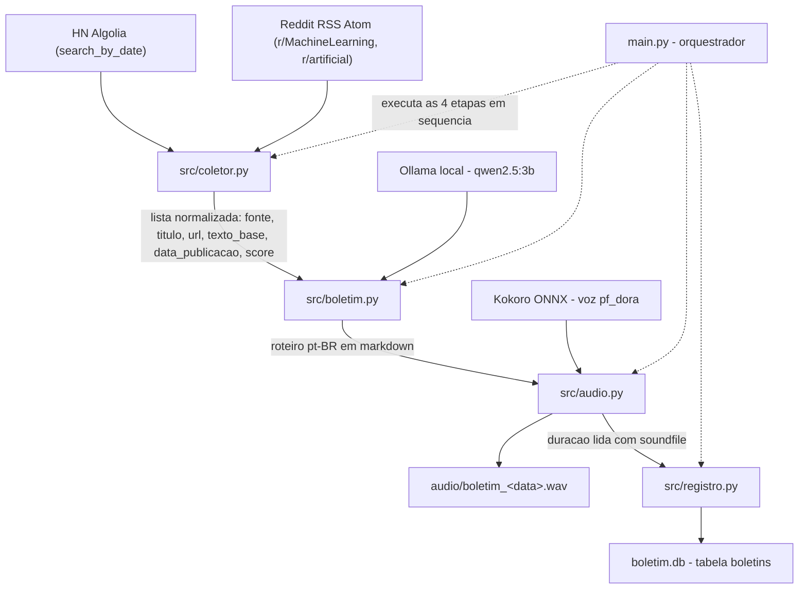
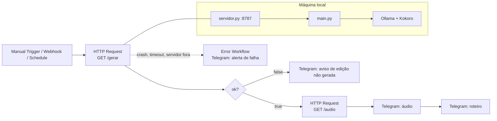

# Boletim IA

Pipeline de automação que **coleta notícias de Inteligência Artificial, escreve um roteiro
em pt-BR com um LLM local e entrega o resultado em áudio**, registrando cada execução num
banco SQLite.

Entrega da disciplina **AI Factory** (PUCPR): Etapa 1 (IDs 1.1, 2, 2.1 e 2.2), Etapa 2
(microsserviço e orquestração no n8n) e etapa final (métricas, dashboard e ética).

| Entrega | Onde está |
|---|---|
| Dashboard de métricas (ID 3.1) | <https://new-emi.github.io/faculdade-automacao-relatorio/dashboard/> |
| Métricas, análise de performance e ROI | Seção 10 |
| Ética, LGPD e IA responsável (ID 3.2) | Seção 11 e [`docs/03_etica_lgpd.md`](docs/03_etica_lgpd.md) |
| Microsserviço e orquestração (Etapa 2) | Seção 9 |

## 1. Visão geral

O projeto monta um **boletim diário de notícias de IA** de ponta a ponta, sem intervenção
manual e sem chaves de API.

- **O que faz:** busca notícias recentes de IA em fontes públicas, usa um LLM local para
  transformá-las num roteiro narrado em português e sintetiza esse roteiro em voz.
- **Para quem:** quem acompanha o mercado de IA e quer o resumo em formato de áudio —
  para ouvir dirigindo, caminhando ou treinando — em vez de ler dezenas de feeds.
- **O que entrega:** um arquivo WAV com a narração do boletim do dia
  (`audio/boletim_<AAAA-MM-DD>.wav`) e um registro da execução (data, quantidade de
  notícias, roteiro completo, caminho do áudio e duração) na tabela `boletins` do
  `boletim.db`.

## 2. Contexto, problema e solução

**Problema.** Acompanhar notícias de IA manualmente todos os dias gera **fadiga de
informação** (dezenas de títulos repetidos sobre os mesmos anúncios) e **atraso**: quem lê
feed por feed gasta tempo que não tem, e o que sobra é uma pilha de abas abertas, não um
resumo aproveitável.

**Solução.** Automatizar o ciclo em 4 etapas:

1. **Coleta** — busca notícias recentes em fontes públicas sem chave de API.
2. **Curadoria por LLM local** — um modelo rodando na própria máquina agrupa as notícias por
   tema e escreve um roteiro fluido em pt-BR (nada é enviado para serviços externos).
3. **Síntese de voz** — o roteiro vira áudio narrado em português, offline.
4. **Registro em banco** — os metadados da execução são gravados em SQLite, criando o
   histórico dos boletins gerados. Uma segunda tabela, `execucoes`, registra também as
   tentativas que falharam (etapa e motivo).

## 3. Diagrama do pipeline



## 4. Estrutura do repositório

```
faculdade-automacao-relatorio/
├── main.py                     # Orquestrador: encadeia as 4 etapas do pipeline
├── servidor.py                 # Microsserviço HTTP (Etapa 2): /saude, /gerar, /audio + fila + métricas
├── CONTEXTO.md                 # Diário técnico do projeto (estado, log de tarefas, fila)
├── README.md                   # Este arquivo
├── requirements.txt            # Dependências com versões fixadas (pip install -r)
├── .gitignore                  # Exclui modelos, banco, áudios de boletim e output/
├── docs/                       # Documentos de entrega: diagnóstico (ID 1.1), Canvas (ID 2) e ética/LGPD (ID 3.2)
│   └── dashboard/              # Dashboard de métricas (ID 3.1), publicado pelo GitHub Pages
├── src/
│   ├── coletor.py              # Input: HN Algolia + Reddit (feed RSS Atom)
│   ├── boletim.py              # Process: roteiro pt-BR via Ollama /api/chat
│   ├── audio.py                # Output: TTS Kokoro ONNX -> WAV PCM_16 24 kHz
│   ├── registro.py             # Persistência: tabelas `boletins` e `execucoes` em SQLite (stdlib)
│   └── retencao.py             # Política de retenção: áudios 30 dias, roteiros 12 meses (LGPD)
├── scripts/
│   ├── download_kokoro.py      # Baixa os modelos do Kokoro para models/ (retomável)
│   ├── smoke_kokoro.py         # Smoke test do TTS: gera audio/smoke.wav
│   ├── md_para_pdf.py          # Converte os documentos de docs/ em HTML (para gerar PDF)
│   ├── verifica_idioma.py      # Confere a revisão de idioma/despedida dos trechos (sem rede)
│   ├── metricas.py             # Lê o boletim.db e gera os dados do dashboard
│   └── experimento_tts.py      # Experimento controlado: re-sintetiza roteiros e mede o RTF
├── audio/                      # Saída de áudio (boletim_<data>.wav; smoke.wav versionado)
│   └── evidencias/             # Áudios citados na documentação, fora da retenção e do git
├── output/                     # Saídas de texto dos testes (ex.: boletim_texto.md)
└── models/                     # Modelos Kokoro (fora do git; reconstruir pelo script)
```

`models/`, `boletim.db`, `audio/boletim_*.wav` e `output/` **não são versionados**: são
artefatos gerados em tempo de execução e reconstruíveis. O `audio/smoke.wav` permanece no
repositório de propósito, como evidência pequena do funcionamento do TTS.

Em `docs/` ficam os documentos de entrega, em Markdown (fonte) e PDF:
`01_diagnostico_id1_1.md` (diagnóstico da necessidade — Critério 1 / ID 1.1),
`02_canvas_id2.md` (Canvas de planejamento — Critério 2 / ID 2) e `03_etica_lgpd.md`
(impacto ético, LGPD e IA responsável — etapa final / ID 3.2). Depois de editar o Markdown,
os PDFs são regerados assim:

```powershell
python scripts/md_para_pdf.py docs/01_diagnostico_id1_1.md docs/02_canvas_id2.md
# abra o .html gerado no navegador e use Ctrl+P -> Salvar como PDF
```

## 5. Stack e pré-requisitos

| Item | Versão / observação |
|------|---------------------|
| Python | 3.11 (validado em 3.11.9) |
| `requests` | 2.34.2 — coleta HTTP |
| `kokoro-onnx` | 0.6.1 — TTS local |
| `numpy` | 2.4.6 — manipulação dos arrays de áudio |
| `onnxruntime` | 1.30.0 — execução do modelo ONNX |
| `phonemizer` | 3.4.0 — fonemização |
| `espeakng-loader` | 0.2.4 — traz o espeak-ng embutido (necessário para pt-BR) |
| `soundfile` | 0.14.0 — leitura/escrita de WAV |
| `edge-tts` | 7.2.8 — instalado, **não usado** no pipeline (ver seção 7) |
| `Markdown` | 3.10.3 — **opcional**, usado só por `scripts/md_para_pdf.py` para gerar os PDFs de `docs/` |
| Ollama | ativo em `http://localhost:11434`, modelo `qwen2.5:3b` baixado |
| ffmpeg | 9.0.1 (build full) disponível no `PATH` |
| Modelos Kokoro | `models/kokoro-v1.0.onnx` (325,5 MB = 325.505.369 B) e `models/voices-v1.0.bin` (28,2 MB = 28.214.398 B), obtidos por `scripts/download_kokoro.py` |

## 6. Setup e execução

### 6.1 Clonar e entrar no projeto

```powershell
git clone <url-do-repositorio> faculdade-automacao-relatorio
cd faculdade-automacao-relatorio
```

Recomendado criar um ambiente virtual:

```powershell
python -m venv .venv
.\.venv\Scripts\Activate.ps1
```

### 6.2 Instalar as dependências

```powershell
python -m pip install -r requirements.txt
```

Equivalente manual, sem versões fixadas:

```powershell
python -m pip install requests kokoro-onnx numpy onnxruntime phonemizer espeakng-loader soundfile edge-tts
```

O LLM roda no Ollama (instale em <https://ollama.com>) com o modelo do pipeline:

```powershell
ollama pull qwen2.5:3b
```

### 6.3 Baixar os modelos do Kokoro

```powershell
python scripts/download_kokoro.py
```

O script é retomável (pula o que já existe e retoma downloads parciais via `Range`), grava
em `models/` e tenta primeiro o HuggingFace, caindo para as releases oficiais do GitHub se
necessário. Smoke test opcional do TTS (gera `audio/smoke.wav`):

```powershell
python scripts/smoke_kokoro.py
```

### 6.4 Rodar o pipeline completo

```powershell
python main.py
```

O orquestrador executa as **4 etapas** em sequência e imprime o progresso:

1. **Coleta** — `coletar_noticias(dias=1, max_por_fonte=5)` busca até 5 itens por fonte
   (o valor pode ser trocado pela variável de ambiente `BOLETIM_MAX_POR_FONTE`)
   (HN + Reddit), o que dá **~10 notícias por edição**. O limite é intencional: com 5 itens por
   fonte a lista já cobre o dia, e com 20 notícias o modelo de 3B passou a **omitir** itens do
   roteiro (ver seção 13). Como o coletor deduplica entre fontes, a edição pode ter menos de
   10 itens.
2. **Roteiro** — `gerar_boletim(noticias)` envia as notícias ao Ollama em **lotes de 5**
   (`/api/chat`, `qwen2.5:3b`, `stream=False`, `temperature=0.6`) e concatena os trechos em pt-BR.
3. **Áudio** — `sintetizar_audio(roteiro, "audio/boletim_<AAAA-MM-DD>.wav")` narra o roteiro
   com a voz `pf_dora`.
4. **Registro** — a duração é medida com `soundfile` e o `registrar_boletim(...)` grava tudo
   em `boletim.db`. A execução em si é auditada à parte: `iniciar_execucao(...)` abre uma
   linha na tabela `execucoes` no começo e `concluir_execucao(...)` a fecha como `sucesso`;
   se alguma etapa falhar, `registrar_falha(...)` a fecha como `falha` com a etapa e o
   motivo.
5. **Retenção** — depois do sucesso, `aplicar_retencao(...)` apaga os áudios com mais de 30
   dias e os roteiros com mais de 12 meses (ver seção 11).

**Saídas geradas:** `audio/boletim_<AAAA-MM-DD>.wav`, um novo registro na tabela
`boletins` e a linha correspondente fechada na tabela `execucoes` de `boletim.db`. Cada
etapa tem `try/except` com mensagem clara; se não houver notícias, o programa avisa e
encerra sem gerar boletim. Toda falha é gravada em `execucoes` (ver 6.5 e 8.4); a única
exceção é a falha ao abrir o próprio banco, que não tem onde ser registrada.

### 6.5 Consultar o histórico no SQLite

O banco tem **duas tabelas separadas**: `boletins` (as edições geradas) e `execucoes`
(a auditoria de cada tentativa, inclusive as que falharam).

```powershell
# edições geradas com sucesso
python -c "import sqlite3;print(*sqlite3.connect('boletim.db').execute('SELECT * FROM boletins').fetchall(), sep='\n')"

# todas as tentativas, com status e motivo da falha
python -c "import sqlite3;print(*sqlite3.connect('boletim.db').execute('SELECT id,data_inicio,data_fim,status,etapa,mensagem_erro FROM execucoes ORDER BY id').fetchall(), sep='\n')"
```

Colunas da tabela `boletins`: `id`, `data_geracao`, `qtd_noticias`, `texto_boletim`,
`caminho_audio`, `duracao_audio_segundos`.

Colunas da tabela `execucoes`: `id`, `data_inicio`, `data_fim`, `status` (`em_andamento`,
`sucesso` ou `falha`), `etapa` (etapa que interrompeu o pipeline: `coleta`, `roteiro`,
`audio`, `leitura_wav` ou `registro`; vazia quando deu certo), `mensagem_erro`,
`qtd_noticias` e `id_boletim` (aponta para a linha de `boletins` quando a execução terminou
com sucesso).

Uma execução interrompida de forma abrupta (Ctrl+C, queda de energia) fica com
`status='em_andamento'` e `data_fim` vazio — sinal de que o processo não chegou a fechar a
própria linha.

### 6.6 Rodar os módulos isoladamente

Cada módulo tem um bloco de teste no `__main__`, sempre a partir da raiz do projeto:

```powershell
python src/coletor.py    # coleta (dias=3, max_por_fonte=5) e mostra as notícias
python src/boletim.py    # coleta (dias=2, max_por_fonte=3), gera o roteiro e salva em output/boletim_texto.md
python src/audio.py      # coleta, gera roteiro e sintetiza audio/boletim_completo.wav
python scripts/verifica_idioma.py   # revisa o idioma dos roteiros já gravados (sem Ollama/rede)
```

## 7. Decisões técnicas justificadas

- **Fontes públicas sem chave de API.** HN Algolia (`hn.algolia.com/api/v1/search_by_date`)
  responde 200 sem credencial. No Reddit, a rota JSON (`r/<sub>/new.json`) foi testada e
  **responde 403 nesta rede** (bloqueio por IP, com qualquer User-Agent); por isso o coletor usa
  a rota **RSS Atom** (`r/<sub>/new/.rss`) como **única rota** — o caminho JSON foi removido do
  código, para não gastar requisições nem poluir o log. O acesso anônimo ao Reddit tem rate limit
  de ~1 requisição/min, e o coletor **espera 60 s** e tenta uma única vez de novo ao receber
  **HTTP 429**. Decisão alinhada à regra do projeto de não usar serviços com credencial.
- **SQLite como banco.** O volume é de um registro por execução; um arquivo único com a
  stdlib (`sqlite3`) dispensa servidor, instalação e dependência externa, e já dá consultas
  SQL para auditoria do histórico.
- **Ausência de scraping das URLs originais.** O LLM recebe apenas o que o coletor entrega
  (fonte, título, URL e `texto_base`). Evita quebrar com HTML/anti-bot e mantém a coleta
  previsível; a limitação correspondente está documentada na seção 13.
- **Kokoro ONNX local em vez de `edge-tts`.** O `edge-tts` depende do serviço do Edge
  (online). O Kokoro roda **offline**, sem serviço externo, sem credencial e sem custo por
  caractere — requisito de privacidade e previsibilidade para o projeto.
- **Voz `pf_dora` com chunks.** O Kokoro degrada com textos longos (os roteiros passam de
  2000 caracteres), então o roteiro é dividido em **chunks de até 400 caracteres**,
  respeitando limites de frase/palavra, e **0,12 s de silêncio** são inseridos entre eles
  para a fala não "colar". A saída é **WAV PCM_16 a 24 kHz**.
- **Regra anti-alucinação no `system prompt`.** O `PROMPT_SISTEMA` de `src/boletim.py`
  proíbe explicitamente inventar fatos, empresas, detalhes técnicos ou significados de
  siglas; com `texto_base` curto ou vazio, o modelo deve se limitar a apresentar o título,
  sem especular.
- **Roteiro sem repetição.** A primeira versão do prompt mandava "agrupar as notícias por
  temas", e o modelo de 3B passou a **reciclar itens** para preencher os blocos temáticos
  (na gravação `id=2` do banco, "Compute:Arena" aparece 3 vezes, "Axiom" 2 vezes e o tema
  "usar Claude para criar jogos" 2 vezes — a coleta daquela execução **não** tinha
  duplicatas, o problema era do LLM). O roteiro passou a ser **linear** (introdução curta,
  notícias uma a uma na ordem recebida, conclusão curta), com **menção única** por notícia
  (cada item da lista aparece exatamente uma vez, e assunto repetido entre entradas é citado
  só uma vez), **proibição de citar fonte/prefixo/URL** (nada de `HN:`, `Show HN:`, `Reddit:`
  ou links) e **proibição de citar data, dia, mês, ano ou horário** (no máximo "hoje"; o
  roteiro antigo inventava "20 de setembro de 2026"). No Ollama, `temperature=0.6` foi
  mantida e somaram-se `repeat_penalty=1.2` e `repeat_last_n=1024`, que penalizam trechos
  repetidos ao longo de **todo** o roteiro (o default do `repeat_last_n` cobre apenas as
  últimas 64 tokens). Complemento de defesa em profundidade: o `src/coletor.py` agora
  **deduplica a entrada** por URL normalizada e por similaridade de título
  (`difflib.SequenceMatcher` >= 0.85, apenas stdlib).
- **Geração em lotes de 5 notícias.** Mesmo com a edição limitada a ~10 notícias, uma única
  chamada ao LLM omitia itens (o roteiro de 83,48 s da `id=3` cobriu 6 dos 10). O
  `gerar_boletim` agora envia as notícias em lotes de `TAMANHO_LOTE = 5`, pede que cada lote
  cubra **todas** as notícias dele e concatena os trechos na ordem, deixando a introdução no
  primeiro e a conclusão no último. Com lote de 3 o resultado medido foi pior (4 trechos: o
  modelo emendou conclusões no meio e voltou a repetir um item), então 5 ficou como valor
  escolhido por medição. O texto já gerado **não** é repassado ao lote seguinte: isso fazia o
  modelo repetir as últimas palavras do trecho anterior (`id=5` emendou "Hey pessoal," no meio
  do roteiro).
- **Texto saneado e verificação de loop no TTS.** O Kokoro entra em **loop** (repete a mesma
  frase várias vezes no áudio) quando o espeak-ng não consegue fonemizar bem a entrada — foi o
  que aconteceu na edição de 21/09, em que o LLM misturou **caracteres chineses** e marcadores
  literais como `[link]` no roteiro. Duas proteções foram adicionadas em `src/audio.py`:
  `_sanitizar_para_tts` limpa o texto antes do TTS (remove URLs, marcadores entre colchetes e
  qualquer caractere fora do alfabeto latino; expande `%`, `$`, `&` e `@` para palavras; garante
  pontuação final) e `_sintetizar_trecho` mede a auto-similaridade do espectro de cada trecho
  (`_repeticao`) e, ao detectar loop, re-sintetiza o trecho **frase por frase**. O prompt ganhou
  ainda a regra de idioma único (só português, só caracteres latinos, sem colchetes). Risco
  residual: uma frase isolada que ainda repita é mantida e reportada no console (`[aviso]`), para
  não perder a notícia do roteiro.
- **Revisão de idioma e de despedida do roteiro.** A edição de 21/09 (`id=10`) saiu com o áudio
  **começando em português e terminando em inglês**: o segundo lote de notícias foi gerado
  inteiramente em inglês, porque as notícias-fonte são em inglês e, por decisão da tarefa 15, o
  texto do trecho anterior **não** é repassado ao lote seguinte — o modelo de 3B ficou sem âncora
  de idioma e respondeu no idioma da entrada. O primeiro lote ainda escreveu uma **despedida no
  meio do roteiro** ("E pronto! ... Até lá, boa sorte e bom trabalho!"), embora a conclusão esteja
  reservada ao último trecho. Três medidas em `src/boletim.py`: o `PROMPT_SISTEMA` passou a dizer
  que **o material recebido é em inglês** e que a resposta é em português (traduzir o sentido,
  nunca copiar frases em inglês); a regra de idioma é **repetida no fim do prompt de cada lote**
  (num modelo de 3B a última instrução lida é a que mais pesa); e `_gerar_trecho` revisa cada
  trecho com `parece_portugues` (marcadores funcionais de português x inglês) e `_tem_despedida`,
  **reenviando o próprio trecho reprovado** ao modelo seguido da correção pedida, por até
  `TENTATIVAS_POR_TRECHO = 2` tentativas. Se o inglês persistir, o pipeline **falha com
  `RuntimeError`** em vez de gravar um áudio em inglês. A heurística foi conferida nos **107
  parágrafos de todos os roteiros do banco**: 7 reprovações, todas legítimas (6 parágrafos em
  inglês e 1 despedida fora do último trecho) — **zero falso positivo**. Reproduzível com
  `python scripts/verifica_idioma.py`, que não usa Ollama nem rede.

## 8. Evidências de funcionamento

### 8.1 Primeira execução ponta a ponta (id=1)

| Métrica | Valor |
|---------|-------|
| Notícias coletadas | 20 (HN + Reddit) |
| Roteiro gerado | 3185 caracteres |
| Arquivo de áudio | `audio/boletim_2026-09-17.wav` |
| Tamanho do áudio | 9.663.850 B |
| Amostras | 4.831.903 |
| Taxa de amostragem | 24000 Hz |
| Formato | PCM_16 |
| Duração | 201,33 s |
| Chunks de TTS | 11 |
| Registro no banco | `id=1` em `boletim.db` (primeira linha da tabela `boletins`) |

Smoke test do TTS: `audio/smoke.wav` (177.260 B, 24000 Hz, 3,69 s, voz `pf_dora`).

**Sobre o arquivo de áudio.** O nome do WAV usa a data do dia, então rodar o pipeline de novo no mesmo dia **substitui** o arquivo anterior: só a última edição fica no disco. O histórico do banco **não** é sobrescrito (cada execução gera uma linha nova) e o campo `caminho_audio` guarda o nome do arquivo **no momento da geração** — por isso todas as linhas apontam para `audio/boletim_2026-09-17.wav` mesmo que o arquivo contenha hoje o áudio da execução mais recente.

Consulta real ao banco (as duas execuções registradas):

```powershell
python -c "import sqlite3;print(*sqlite3.connect('boletim.db').execute('SELECT id, data_geracao, qtd_noticias, caminho_audio, duracao_audio_segundos FROM boletins').fetchall(), sep='\n')"
```

Saída obtida:

```
(1, '2026-09-17 02:34:21', 20, 'audio/boletim_2026-09-17.wav', 201.32929166666668)
(2, '2026-09-17 04:15:57', 20, 'audio/boletim_2026-09-17.wav', 121.07066666666667)
```

| Métrica | Valor |
|---------|-------|
| Data/hora da execução | 2026-09-17 05:02:04 |
| Notícias coletadas | 10 (5 HN + 5 Reddit) |
| Roteiro gerado | 2.266 caracteres |
| Arquivo de áudio | `audio/boletim_2026-09-17.wav` |
| Tamanho do áudio | 6.668.230 B |
| Amostras | 3.334.093 |
| Taxa de amostragem | 24000 Hz |
| Formato | PCM_16 |
| Duração | 138,92 s |
| Chunks de TTS | 9 |
| Registro no banco | `id=4` em `boletim.db` |

Os áudios das execuções anteriores foram **descartados** para manter o diretório limpo: no disco ficam três WAVs — o da edição de 17/09 (`audio/boletim_2026-09-17.wav`, 6.668.230 B), o da última edição de 21/09 (`audio/boletim_2026-09-21.wav`, 4.743.912 B) e a cópia preservada da edição de 21/09 que saiu com o idioma misturado (`audio/boletim_2026-09-21_idioma_misto.wav`, 6.916.266 B, ver 8.3); todas as execuções continuam registradas no `boletim.db`.

### 8.2 Edição de 21/09/2026 (id=8) — correção de loop no TTS

A edição de 21/09 saiu com a narradora **repetindo a mesma frase várias vezes** em um trecho. O
roteiro gravado no banco mostrou a causa: o LLM misturou **caracteres chineses** e marcadores
literais como `[link]` no texto, e o espeak-ng/Kokoro entra em **loop** com esse tipo de entrada.
Medição no trecho culpado: **35,42 s** de áudio com auto-similaridade **0,94** (loop); depois do
saneamento: **21,11 s** com **0,82** (sem loop). A correção tem duas partes: `_sanitizar_para_tts`
(limpa URLs, colchetes, símbolos soltos e caracteres fora do alfabeto latino) e `_repeticao` +
`_sintetizar_trecho` (mede a auto-similaridade do espectro de cada trecho e, ao detectar loop,
re-sintetiza o trecho frase por frase); o prompt também ganhou a regra de idioma único. Edição
regerada:

| Métrica | Valor |
|---------|-------|
| Data/hora da execução | 2026-09-21 20:31:49 |
| Notícias coletadas | 10 (5 HN + 5 Reddit) |
| Roteiro gerado | 2.349 caracteres |
| Arquivo de áudio | `audio/boletim_2026-09-21.wav` |
| Tamanho do áudio | 6.666.666 B |
| Amostras | 3.333.311 |
| Taxa de amostragem | 24000 Hz |
| Formato | PCM_16 |
| Duração | 138,89 s |
| Verificação de loop | auto-similaridade máxima 0,80 (limite 0,90) — **sem loop** |
| Registro no banco | `id=8` em `boletim.db` |

Consulta real ao banco, com as **onze** execuções registradas:

```powershell
python -c "import sqlite3;[print(r[0],r[1],r[2],r[3],round(r[4],2)) for r in sqlite3.connect('boletim.db').execute('SELECT id,data_geracao,qtd_noticias,caminho_audio,duracao_audio_segundos FROM boletins')]"
```

Saída obtida:

```
1 2026-09-17 02:34:21 20 audio/boletim_2026-09-17.wav 201.33
2 2026-09-17 04:15:57 20 audio/boletim_2026-09-17.wav 121.07
3 2026-09-17 04:48:57 10 audio/boletim_2026-09-17.wav 83.48
4 2026-09-17 05:02:04 10 audio/boletim_2026-09-17.wav 138.92
5 2026-09-17 05:06:00 10 audio/boletim_2026-09-17.wav 93.11
6 2026-09-21 20:08:35 10 audio/boletim_2026-09-21.wav 148.82
7 2026-09-21 20:24:52 10 audio/boletim_2026-09-21.wav 93.36
8 2026-09-21 20:31:49 10 audio/boletim_2026-09-21.wav 138.89
9 2026-09-21 21:01:15 10 audio/boletim_2026-09-21.wav 141.81
10 2026-09-21 21:24:28 10 audio/boletim_2026-09-21.wav 144.09
11 2026-09-21 21:38:20 10 audio/boletim_2026-09-21.wav 98.83
```

### 8.3 Edição de 21/09/2026 (id=11) — correção da deriva de idioma

O áudio da execução anterior (id=10) começou em português e terminou em inglês; o
diagnóstico e a correção estão na seção 7. Edição regerada:

| Métrica | Valor |
|---------|-------|
| Data/hora da execução | 2026-09-21 21:38:20 |
| Notícias coletadas | 10 (5 HN + 5 Reddit) |
| Roteiro gerado | 1.659 caracteres |
| Marcadores de idioma do roteiro | 58 de português, **0** de inglês |
| Arquivo de áudio | `audio/boletim_2026-09-21.wav` |
| Tamanho do áudio | 4.743.912 B |
| Amostras | 2.371.934 |
| Taxa de amostragem | 24000 Hz |
| Formato | PCM_16 |
| Duração | 98,83 s |
| Chunks de TTS | 5 |
| Verificação de loop | auto-similaridade máxima 0,78 (limite 0,90) — **sem loop** |
| Registro no banco | `id=11` em `boletim.db` |

```powershell
python scripts/verifica_idioma.py
```

### 8.4 Execuções que falharam

O `main.py` registra **toda tentativa** na tabela `execucoes`, separada de `boletins`, com
data de início/fim, status, etapa que interrompeu o pipeline e a mensagem de erro. A
consulta está na seção 6.5.

O histórico anterior a essa mudança **não tem linhas** em `execucoes`: as execuções de
17/09 e 21/09 já estavam em `boletins` quando a tabela foi criada, e as que abortaram
deixaram rastro apenas no console. O diagnóstico delas está em texto nas seções 8.2 e 8.3 e
no `CONTEXTO.md` (log de tarefas). O `boletim.db` existente não foi reescrito: a auditoria
começa na próxima execução.

Desde a etapa final, os áudios de 17/09 e 21/09 citados nesta seção ficam em
`audio/evidencias/`, fora da política de retenção (seção 11) e fora do git.

## 9. Etapa 2 — microsserviço e orquestração no n8n

Na Etapa 2, o pipeline virou um **microsserviço HTTP local** (`servidor.py`, só biblioteca
padrão) e passou a ser orquestrado pelo **n8n**, que entrega o boletim no **Telegram**.



| Rota | O que faz |
|---|---|
| `GET /saude` | Diz se o serviço está no ar e se o pipeline está ocupado |
| `GET /gerar` | Roda o `main.py`, grava a requisição na tabela `requisicoes` e devolve um JSON com o roteiro, a duração do áudio e o tempo de cada etapa |
| `GET /gerar?max_por_fonte=N` | O mesmo, com outra carga (usado no teste de carga) |
| `GET /audio` | Serve o WAV do dia como binário, para o n8n baixar |

**Tratamento de erros em duas camadas** (defesa em profundidade, a mesma filosofia da Etapa 1):

- **Erro de negócio** (o pipeline respondeu, mas falhou, por exemplo com o Ollama desligado):
  o `/gerar` responde `ok: false` com o motivo, o nó **IF** desvia para um aviso amigável no
  Telegram e o fluxo termina sem alarme.
- **Erro de infraestrutura** (o fluxo morre antes do IF: servidor fora do ar, timeout, queda
  de rede): um **Error Workflow** separado, ligado nas configurações do fluxo principal,
  manda um alerta de falha. Ele só dispara em execuções de produção (webhook ou agendamento).

**Configuração sem segredos no código:** o token do bot fica no cofre de credenciais do n8n;
a porta e o interpretador vêm de variáveis de ambiente (`BOLETIM_PORTA`, `BOLETIM_PYTHON`);
o nó do Telegram tem **Retry On Fail** (3 tentativas, 5 s de intervalo).

Para subir o serviço (com o Ollama aberto):

```powershell
$env:BOLETIM_PYTHON = "C:\caminho\para\Python311\python.exe"   # opcional: fixa o Python com os pacotes
python servidor.py
Invoke-RestMethod http://127.0.0.1:8787/saude
```

**Fila de um pedido por vez (etapa final).** O teste de stress da Etapa 2 mostrou que três
disparos simultâneos disputam o mesmo LLM e estouram o timeout de 15 minutos. O
`servidor.py` agora usa uma trava (`threading.Lock`): com o pipeline ocupado, o pedido
recebe `status: "ocupado"` na hora, em vez de esperar até o timeout.

## 10. Métricas de performance e ROI (etapa final)

📊 **Dashboard:** <https://new-emi.github.io/faculdade-automacao-relatorio/dashboard/>
(código em `docs/dashboard/`).

### 10.1 Como as métricas foram coletadas

O próprio sistema mede seu comportamento (**instrumentação**): o `main.py` imprime o tempo
de cada etapa (`[tempo] roteiro 152.31`) e o `servidor.py` grava cada pedido na tabela
`requisicoes` do `boletim.db`, com latência total, status (`sucesso`, `falha`, `timeout`
ou `ocupado`), etapa da falha e tempo de cada etapa. O `scripts/metricas.py` lê o banco,
calcula tudo e gera os dados do dashboard:

```powershell
python scripts/metricas.py
```

Amostra (10 a 12/11/2026, um notebook com 16 GB de RAM, Ollama `qwen2.5:3b`):

| Recorte | Pedidos | Desenho |
|---|---|---|
| Amostra padrão | 13 | Carga de produção (10 notícias); 10 seguidos, 1 isolado em cada dia e 1 no teste de concorrência |
| Teste de carga | 5 | 4, 8, 12, 16 e 20 notícias, com 5 min de pausa entre as rodadas |
| Teste de concorrência | 3 | Três pedidos disparados no mesmo segundo |

### 10.2 Resultados

| Métrica | Valor |
|---|---|
| **Taxa de sucesso do pipeline** | **18 de 18 (100%)**; mais 2 pedidos recusados pela fila, como planejado |
| Taxa de sucesso na fase de desenvolvimento (n8n, 18 e 19/10) | 8 de 23 (35%), incluindo 6 testes de stress feitos de propósito |
| **Latência mediana** (10 notícias) | **253,8 s (4,2 min)**; de 178,2 s a 324,3 s; desvio-padrão de 39,8 s |
| Coleta | 1,6 s (0,6% do tempo) |
| Roteiro (LLM) | 83,4 s (31,8%) |
| **Áudio (Kokoro)** | **177,4 s (67,6%)** — o gargalo |
| Registro no SQLite | 0,02 s |
| Teste de carga, 4 → 20 notícias | Roteiro de 68 s → 221 s (cerca de 11 s por notícia); pior total 531,6 s (16 notícias), todos abaixo do limite de 900 s |
| Concorrência, 3 pedidos simultâneos | Antes (Etapa 2): 3 timeouts de 15 min, 0 boletins. Depois: 1 boletim em 324,3 s e 2 recusas instantâneas |

Os tempos por etapa são medianas da amostra padrão. Os valores brutos estão na tabela do
dashboard e no banco.

### 10.3 Análise de performance

**O gargalo é a síntese de voz, não o LLM.** A primeira execução medida sugeria o contrário
(LLM com 64% do tempo). Com a amostra completa, o áudio ficou com 67,6%. Uma medição isolada
engana; a amostra corrigiu a conclusão.

**O tempo do áudio varia com o estado da máquina, não com o texto.** A medida usada é o
**fator de tempo real (RTF)**: segundos de processamento por segundo de áudio. No notebook,
o RTF oscilou entre 0,42 e 1,56. Para separar as causas, foi feito um **experimento
controlado** (`scripts/experimento_tts.py`): os roteiros de 4 pedidos (2 rápidos e 2 lentos)
foram sintetizados de novo pelo mesmo `src/audio.py` numa máquina estável. Os 4 levaram o
mesmo tempo (RTF 0,67 a 0,68), e nenhum acionou a re-síntese por loop. Conclusão: a variação
vem do ambiente do notebook. As hipóteses mais prováveis são aquecimento do processador
(*thermal throttling*) e disputa com outros programas; memória cheia é pouco provável (havia
cerca de 5 GB livres). Para apontar a causa exata, falta registrar CPU e temperatura (ver
10.5).

**Partida a frio do LLM.** Depois de 5 minutos parado, o Ollama descarrega o modelo da
memória. No pedido feito com o notebook parado há mais de uma hora, o roteiro levou 172,7 s,
contra a mediana de 83,4 s.

**Escalabilidade.** O roteiro cresce de forma quase linear (lotes de 5 notícias com custo
parecido). Até 20 notícias o sistema fica abaixo do limite de 15 minutos; com 60 notícias
(teste da Etapa 2) ele estoura.

### 10.4 ROI

O ganho é medido em horas. Premissas declaradas: curadoria manual de 20 a 35 min por dia
(estimativa da autora), 12 a 15 h investidas na construção (estimativa), 22 dias de uso por
mês e 2,2 min de escuta por dia (mediana medida), contados como tempo gasto.

| Cenário | Horas poupadas/mês | Payback | ROI em 12 meses | ROI com 1 h/mês de manutenção |
|---|---|---|---|---|
| Pessimista (20 min/dia, 15 h investidas) | 6,5 h | 2,3 meses | 422% | 342% |
| Otimista (35 min/dia, 12 h investidas) | 12,0 h | 1,0 mês | 1.103% | 1.003% |

ROI = (horas poupadas em 12 meses − horas investidas) ÷ horas investidas. O custo de
operação é praticamente zero: sem API paga e sem nuvem, e cerca de 0,13 kWh de energia por
mês (estimativa para um notebook de ~60 W). A conclusão se mantém mesmo com custo de
manutenção (**análise de sensibilidade**).

### 10.5 Propostas de melhoria

| Evidência | Melhoria | Situação |
|---|---|---|
| 3 timeouts com pedidos simultâneos | Fila de um pedido por vez | ✅ Implementada |
| Falhas sem rastro na Etapa 2 | Instrumentação: tabelas `requisicoes` e `execucoes` | ✅ Implementada |
| Áudio = 67,6% do tempo | Rodar o Kokoro na GPU (`onnxruntime-directml` no Windows) | Proposta |
| RTF de 0,42 a 1,56 no notebook x 0,67 a 0,68 na máquina estável | Registrar CPU, memória e temperatura por execução (`psutil`) | Proposta |
| Roteiro de 172,7 s na partida a frio x 83,4 s de mediana | Manter o modelo carregado com `keep_alive` no Ollama | Proposta |
| Variação causada por outros programas e aquecimento | Agendar a geração para horários com o notebook ocioso | Proposta |
| Reddit encerra o RSS em 13/11/2026 | Substituir a fonte por outras com acesso oficial | Proposta (ver 11) |

## 11. Ética, LGPD e IA responsável

A análise completa está em [`docs/03_etica_lgpd.md`](docs/03_etica_lgpd.md): inventário dos
dados, enquadramento na LGPD, 8 riscos com mitigação, IA responsável e implicações sociais.
Os pontos principais:

- **LGPD.** O uso atual é pessoal e não econômico, então a lei não se aplica (art. 4º, I).
  Mesmo assim o projeto segue seus princípios, porque o código é público e pode ser reusado
  num contexto em que ela se aplica.
- **Retenção implementada** (`src/retencao.py`): áudios com mais de 30 dias e roteiros com
  mais de 12 meses são apagados a cada execução bem-sucedida (princípio da necessidade e
  art. 16). As métricas não têm dado pessoal e ficam. `python src/retencao.py` simula sem
  apagar; os arquivos de `audio/evidencias/` ficam protegidos.
- **Privacy by design.** Coleta sem autor, processamento local e token fora do código. A busca
  `git log -S` confirmou que o token do bot nunca entrou num commit.
- **Termos de uso.** O Reddit encerra o RSS em 13/11/2026 por causa de raspagem em massa. A
  decisão do projeto é não contornar o bloqueio. O coletor já trata a falha, e o boletim
  passa a usar só o Hacker News até a fonte ser substituída.

## 12. Declaração de uso de IA

Este projeto foi desenvolvido com apoio de assistentes de IA como par de programação:
escrita de código sob direção, depuração e revisão. As decisões de escopo e de design, a
execução dos testes, a validação dos resultados e a documentação são da autora. Cada
mudança foi testada com execução real antes de ser aceita, e o histórico de commits
registra a evolução do trabalho.

## 13. Roadmap

- **Substituir o Reddit** por fontes com acesso oficial e mais diversas, incluindo veículos
  brasileiros.
- **Enviar os links das notícias originais** junto com o áudio no Telegram, para o ouvinte
  conferir os fatos.
- **Kokoro na GPU**, **telemetria de CPU e temperatura** e **`keep_alive` no Ollama** (ver 10.5).
- **Enriquecimento pelas URLs originais** — extrair o texto das matérias para reduzir a
  dependência de títulos curtos, respeitando o `robots.txt` e os termos de cada site.
- **Upgrade para modelo 7B+** — mais aderência ao material de origem e menor risco residual
  de extrapolação.
